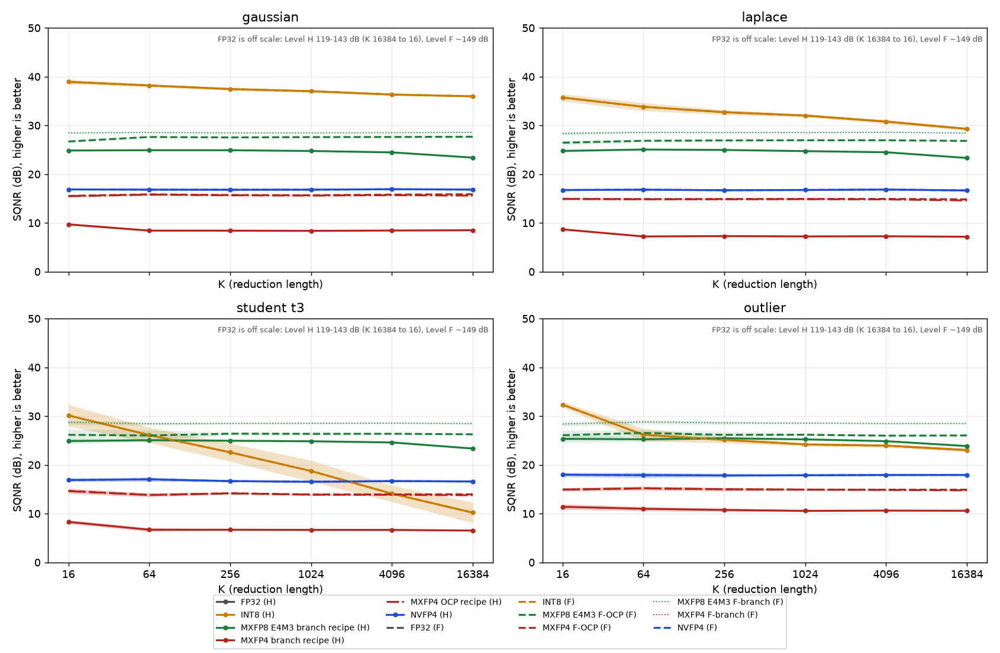

# M7.A accuracy study: FP32, INT8, MXFP8, MXFP4, NVFP4

Date: 2026-10-21. Status: done. Every number below comes from a CSV in `docs/m7a/` (written by `refmodel/accuracy_sweep.py` and
`refmodel/transformer_formats.py`; the tables are printed by `refmodel/m7a_tables.py`). No RTL, no Verilator, no real-model weights.
The step log with the evidence for each step is `logs/m7a.steps`.

## What was measured

How accurately each design computes a matmul, compared with an FP64 matmul of the **unquantized** inputs, at two levels:

- **Level F (format).** Quantize with the format's recipe, dequantize, multiply in FP64. What the format alone can do.
- **Level H (hardware).** The design's own arithmetic (accumulation order, rounding, accumulator width), as a numpy model that was
  checked bit for bit against **that design's own Spike model** (next section but one). What the implementation does.

Designs (each on its own unmodified tree, as in `docs/M7-measurement-plan.md`):

| name | tree | Level-H model |
|---|---|---|
| FP32 | `~/chipyard`, upstream Gemmini 8c3f9923, `FPGemminiRocketConfig` (DIM 4) | `hw_models.fp32_h`: per K tile of 4, `r += a*b` (separate multiply and add, float32), then accumulator `+=` |
| INT8 | `~/chipyard`, upstream 8c3f9923, default INT8 (DIM 16) | `int8.hw_matmul`: per-tensor symmetric quantization, exact INT32 accumulation, FP64 dequantize |
| MXFP8 E4M3 | `~/chipyard-mx`, MX base 266c593f (libgemmini 87663107) | `mx.hw_matmul`: products truncated to 3 fractional bits, per-lane accumulator ramp (4,4) x8, (4,5) x2, (4,6) x5, (8,7), E8M0 scale per 32 K, BF16 accumulation across tiles |
| MXFP4 | same | same model, E2M1 elements |
| NVFP4 | `~/chipyard-mx` branch `nvfp4` (our design) | `hw_dot.hw_matmul_v0`: exact integer block sums, float32 block scaling, FP32 accumulation |

Inputs (`accuracy_sweep.make_inputs`): A is 64 x K and B is K x 64, drawn from Gaussian, Laplace, Student-t (nu = 3), or "outlier"
(Gaussian, with one K-column in 64 of A, at least one, multiplied by 100). K in {16, 64, 256, 1024, 4096, 16384}, 10 seeds each.
Metrics per cell: SQNR (dB), relative Frobenius error, max abs error, max relative error (outputs with |ref| > 1e-3 x max|ref|),
and cosine. Tables show mean +/- 95% CI (Student-t, 9 dof) over seeds. This is a synthetic study, not a real model.

CSV files (the scripts print the row counts, which equal formats x inputs x K x seeds):

- `docs/m7a/accuracy_F.csv`: 1680 rows = 7 formats (fp32, int8, mxfp8_ocp, mxfp4_ocp, mxfp8_branch, mxfp4_branch, nvfp4) x 4 x 6 x 10.
- `docs/m7a/accuracy_H.csv`: 2400 rows = 10 formats x 4 x 6 x 10 (the 5 designs, 2 ablations, `fp32_fused`, and the 2 OCP-recipe MX runs).
- `docs/m7a/accuracy_summary.csv`: 408 rows, mean and 95% CI per (level, format, input, K).
- `docs/m7a/transformer.csv`: 15 rows (section "Tiny transformer").
- Controls: the no-quantization path gives error exactly 0 and SQNR = inf (checked at the start of every sweep and in pytest); the metric refuses to compare 0 elements;
  the sweep exits nonzero if any cell compared 0 elements or the row count is wrong.

## Recipe finding: the MX branch does not quantize with the OCP recipe

OCP MX v1.0: shared exponent = floor(log2(block amax)) - emax_elem (E2M1: 2, E4M3: 8), so scaled block maxima sit near the top of
the element range (256 to 448 for E4M3, 4 to 6 for E2M1). The MX branch's committed test data (`include/matmul_*.h`, written by
`gen_matmul_llama.py` using MXQuant's `quantize_mx_block32`) uses the "e2e" convention instead: **shared exponent = floor(log2(block amax)),
with no emax_elem term**. The header comments say so ("Block scales use X = 2^(floor(log2 amax) - 0)", "Operands use the e2e convention").
Measured on the committed headers (`logs/m7a-recipe.py`, output in `logs/m7a-recipe.out`): the scaled block maximum of A is in [1, 2] for 100% of the
32-element blocks of the two FP8 headers (64x64 and 128x128), and in {1.0, 1.5, 2.0} for every block of the two FP4 headers; none are near 448 or 6.

Why: the in-array accumulator `(4,4)` holds values below 2^8. With OCP-recipe E4M3 data, products saturate at 448 and the first accumulate
overflows to infinity. This reproduces here: **MXFP8 on the MX hardware model with OCP-recipe data gives inf/NaN in at least 99.7% of the outputs of every cell**
(Level H `mxfp8_ocp`: 983,029 of 983,040 outputs), and Spike agrees bit for bit on 3 such matrices, so it is the real Spike behaviour, not a model bug. MXFP4 with OCP data stays finite
(products are at most 36) and works, so for MXFP4 both recipes run on the hardware.

The branch's other generators (`fp4_matmul_model.py`, `fp8_matmul_model.py`) do something else again: they draw `randn` operands, round them
to the element format toward zero, and attach random power-of-two block scales 2^-3 to 2^3 unrelated to the data. That is test-vector
generation for the datapath, not an accuracy recipe, so it is not used here.

Consequence for the study: following the brief, **the branch recipe is used for the headline MX Level H numbers** and the OCP recipe is reported next to it
(Level F for both MX formats, Level H for MXFP4; MXFP8 with OCP data cannot run on this hardware). For MXFP4 the choice matters a lot (see the tables). Caveat:
the MXQuant source (`npu-exploration`, a git submodule that is not checked out here) was not available, so the branch recipe is inferred from its output
(scale convention from the headers; element rounding assumed RNE with saturation, as the libgemmini comments say). If MXQuant rounds elements differently,
the branch-recipe numbers would move slightly; the Spike-verified hardware arithmetic would not.

## What was verified against Spike, and what was not

Level-H models are accepted only with 0 mismatches against the design's own Spike model on the same inputs. The tests are C programs under
`hw/tests/`, built with the rocc-tests `bareMetalC` compile line (`logs/m7a-build.sh`; outputs in `~/nvfp4-logs/m7a/`; no file in either tree was edited). Run
from the tree's own shell (`source ~/miniforge3/etc/profile.d/conda.sh; cd ~/chipyard[-mx]; source env.sh`). Logs: `~/nvfp4-logs/m7a/<name>.spike.log`.

| model | Spike command (binaries in `~/nvfp4-logs/m7a/bin/`) | matrices | outputs | mismatches |
|---|---|---|---|---|
| INT8 (stock; full-width INT32 through stock `tiled_matmul_auto`, WS) | `spike --extension=gemmini m7a_int8` | 5: 64x64x1024, 48x32x2048, 64x64x4096, 32x64x1024, 16x16x16384 (all +-127, max 264,257,536) | 12,032 | **0** |
| FP32 (stock, DIM 4), separate multiply+add model | `spike --extlib=$HOME/nvfp4-logs/m7a/libgemmini-fp32/libgemmini_fp32.so --extension=gemmini m7a_fp32` | 5: 64x64x1024 (x2), 32x32x4096, 16x16x16384, 20x28x260 | 10,032 | **0** |
| FP32, fused multiply-add model (as in Arithmetic.scala) | same run | same | 10,032 | 6,454 (so Spike is not fused) |
| MXFP8 E4M3 (MX base) | `spike --extension=gemmini m7a_mx_fp8` | 24: 4 inputs x K 1024/2048/4096, 8 small multi-tile, 2 OCP overflow, 2 wide-range | 34,816 | **0** |
| MXFP4 (MX base) | `spike --extension=gemmini m7a_mx_fp4` | 24: same layout (K = 4096 at 32x32) | 48,128 | **0** |
| NVFP4 (our branch) | `spike --extension=gemmini_nvfp4 <name>` for `nvfp4_m7a_k1024`, `_k2048`, `_gaussian`, `_laplace`, `_student_t3`, `_outlier` | 6: 64x64x1024 (x5), 32x32x2048 | 21,504 | **0** |

Notes on the table:

- **Negative controls (each must break).** INT8: one expected INT32 changed by +1 gives 1 mismatch (`logs/m7a-neg-int8.sh`). NVFP4: one expected bit flipped gives
  1 mismatch (`logs/m7a-neg-nvfp4.sh`). MX: the model's in-array accumulator rounding changed from RNE to round-toward-zero gives 8,136 of 8,192 mismatches (FP8) and 150 of 8,192 (FP4)
  on two K = 1024 matrices (`m7a_mx_fp8ctl`, `m7a_mx_fp4ctl`). FP32: the fused model is the control (6,454 mismatches).
- The MX tests were also run with a libgemmini rebuilt from the pristine MX base commit (87663107, `logs/m7a-mxbase.sh`, loaded with `--extlib`): the same 0 mismatches.
- In the MX bit comparison any NaN equals any NaN (overflowing OCP cases produce inf and NaN); infinities and every finite value are compared bit for bit.
- NVFP4: the bit-exact refmodel path is `hw_matmul_v0` (float32 block scaling), not `hw_matmul` (float64); the sweep uses `hw_matmul_v0`. K = 2048 only fits at M = N = 32 (the 4096-byte scale window per operand); 64x64 fits up to K = 1024.
- FP32 needed a libgemmini and a rocc-tests include directory built for the FP32 config. The FP32 `gemmini_params.h` was generated **without elaborating the config and without touching
  `~/chipyard`**: `logs/m7a-genparams.py` is a Python port of `generateHeader` and was validated by reproducing the stock INT8 `gemmini_params.h` byte for byte; the libgemmini
  `.so` is the unmodified stock `gemmini.cc` compiled against that header (`logs/m7a-fp32.sh`; Spike prints `dim = 4`). An attempt to print the header from an `sbt console` failed on a jline `NoSuchMethodError` and was dropped.
- No test file was added to either tree: all Spike inputs live in this repo (`hw/tests/m7a_*`, `hw/tests/nvfp4_m7a_*`) and the build products in `~/nvfp4-logs/m7a/`. The large generated data headers are reproducible with
  `python refmodel/export_m7a.py {int8|fp32|mx fp8|mx fp4|nvfp4 ...}` and are not committed.

**Not verified**

- The FP32 PE's fused multiply-add. `Arithmetic.scala` (`FloatArithmetic.mac`, `MulAddRecFN`) is fused, but libgemmini models `results += a*b` as two roundings, so the Spike-verified FP32 Level H is the separate model. The fused model (`fp32_fused`) is
  reported as an unverified ablation (no Verilator in M7.A). The two agree within the CI in SQNR at every K tested (see the ablation table).
- No M7.A matrix was run in Verilator. NVFP4 was bit-exact in RTL through M6.5 and the existing MX tests pass in RTL, but the study's MX and NVFP4 numbers rest on equality with Spike's model.
- INT8 output requantization (`acc_scale` at mvout) is not modelled; the study uses the full-width INT32 result, as in M4.
- The INT8 comparison uses one per-tensor scale for A and one for B. Per-channel scales (an optional extra in the plan) were not run.

## Results

### K = 1024 summary (SQNR in dB, higher is better; 10 seeds, M = N = 64)

| level | format | gaussian | laplace | student_t3 | outlier |
|---|---|---|---|---|---|
| H | FP32 (stock, DIM 4) | 130.5 +/- 0.1 | 130.6 +/- 0.1 | 130.6 +/- 0.3 | 130.7 +/- 0.4 |
| F | FP32 | 148.8 +/- 0.1 | 148.9 +/- 0.1 | 148.9 +/- 0.2 | 149.0 +/- 0.1 |
| H | INT8 (stock) | 37.0 +/- 0.3 | 32.0 +/- 0.3 | 18.7 +/- 2.2 | 24.2 +/- 0.3 |
| F | INT8 | 37.0 +/- 0.3 | 32.0 +/- 0.3 | 18.7 +/- 2.2 | 24.2 +/- 0.3 |
| H | MXFP8 E4M3, branch recipe | 24.8 +/- 0.0 | 24.7 +/- 0.1 | 24.8 +/- 0.1 | 25.2 +/- 0.2 |
| F | MXFP8 E4M3, branch recipe | 28.5 +/- 0.1 | 28.5 +/- 0.1 | 28.5 +/- 0.2 | 28.6 +/- 0.1 |
| F | MXFP8 E4M3, OCP recipe | 27.6 +/- 0.1 | 27.0 +/- 0.1 | 26.4 +/- 0.3 | 26.2 +/- 0.2 |
| H | MXFP8 E4M3, OCP recipe | inf/NaN (all seeds) | inf/NaN (all seeds) | inf/NaN (all seeds) | inf/NaN (all seeds) |
| H | MXFP4, branch recipe | 8.4 +/- 0.1 | 7.2 +/- 0.1 | 6.7 +/- 0.2 | 10.6 +/- 0.2 |
| F | MXFP4, branch recipe | 8.4 +/- 0.1 | 7.2 +/- 0.1 | 6.7 +/- 0.2 | 10.6 +/- 0.2 |
| F | MXFP4, OCP recipe | 15.7 +/- 0.1 | 14.9 +/- 0.1 | 13.9 +/- 0.1 | 14.9 +/- 0.2 |
| H | MXFP4, OCP recipe | 15.6 +/- 0.1 | 14.9 +/- 0.1 | 13.9 +/- 0.1 | 14.9 +/- 0.2 |
| H | NVFP4 | 16.8 +/- 0.0 | 16.8 +/- 0.1 | 16.5 +/- 0.2 | 17.9 +/- 0.1 |
| F | NVFP4 | 16.8 +/- 0.0 | 16.8 +/- 0.1 | 16.5 +/- 0.2 | 17.9 +/- 0.1 |

Relative Frobenius error at K = 1024 (lower is better):

| level | format | gaussian | laplace | student_t3 | outlier |
|---|---|---|---|---|---|
| H | FP32 (stock, DIM 4) | 0.0000 +/- 0.0000 | 0.0000 +/- 0.0000 | 0.0000 +/- 0.0000 | 0.0000 +/- 0.0000 |
| F | FP32 | 0.0000 +/- 0.0000 | 0.0000 +/- 0.0000 | 0.0000 +/- 0.0000 | 0.0000 +/- 0.0000 |
| H | INT8 (stock) | 0.0141 +/- 0.0004 | 0.0251 +/- 0.0009 | 0.1225 +/- 0.0330 | 0.0619 +/- 0.0023 |
| F | INT8 | 0.0141 +/- 0.0004 | 0.0251 +/- 0.0009 | 0.1225 +/- 0.0330 | 0.0619 +/- 0.0023 |
| H | MXFP8 E4M3, branch recipe | 0.0578 +/- 0.0003 | 0.0580 +/- 0.0009 | 0.0573 +/- 0.0007 | 0.0548 +/- 0.0013 |
| F | MXFP8 E4M3, branch recipe | 0.0377 +/- 0.0005 | 0.0374 +/- 0.0005 | 0.0375 +/- 0.0007 | 0.0373 +/- 0.0004 |
| F | MXFP8 E4M3, OCP recipe | 0.0417 +/- 0.0005 | 0.0449 +/- 0.0004 | 0.0481 +/- 0.0017 | 0.0491 +/- 0.0012 |
| H | MXFP8 E4M3, OCP recipe | inf/NaN (all seeds) | inf/NaN (all seeds) | inf/NaN (all seeds) | inf/NaN (all seeds) |
| H | MXFP4, branch recipe | 0.3816 +/- 0.0045 | 0.4350 +/- 0.0063 | 0.4648 +/- 0.0082 | 0.2965 +/- 0.0058 |
| F | MXFP4, branch recipe | 0.3816 +/- 0.0045 | 0.4350 +/- 0.0063 | 0.4648 +/- 0.0082 | 0.2965 +/- 0.0057 |
| F | MXFP4, OCP recipe | 0.1645 +/- 0.0021 | 0.1796 +/- 0.0027 | 0.2016 +/- 0.0029 | 0.1794 +/- 0.0037 |
| H | MXFP4, OCP recipe | 0.1658 +/- 0.0021 | 0.1805 +/- 0.0027 | 0.2024 +/- 0.0027 | 0.1796 +/- 0.0037 |
| H | NVFP4 | 0.1442 +/- 0.0008 | 0.1453 +/- 0.0016 | 0.1492 +/- 0.0027 | 0.1280 +/- 0.0017 |
| F | NVFP4 | 0.1442 +/- 0.0008 | 0.1453 +/- 0.0016 | 0.1492 +/- 0.0027 | 0.1280 +/- 0.0017 |

Plots (`docs/m7a/`): `sqnr_vs_k_all.png` (all four inputs), `sqnr_vs_k_gaussian.png`, `sqnr_vs_k_laplace.png`, `sqnr_vs_k_student_t3.png`, `sqnr_vs_k_outlier.png`.
Level H is solid, Level F dashed (MX: OCP recipe dashed, branch recipe dotted; MXFP4 Level H with the OCP recipe dash-dot). The y axis stops at 50 dB, so FP32 (119 to 143 dB at Level H) is off the plot.



What the K sweep shows (all from `accuracy_summary.csv`):

- FP32 Level H falls from about 143 dB (K = 16) to 130.5 dB (K = 1024) to 118.8 dB (K = 16384): float32 rounding accumulating down a long reduction. Level F is flat at about 149 dB.
- INT8 loses accuracy with K on heavy-tailed data (Student-t: 30.1 dB at K = 16, 18.7 dB at K = 1024, 10.2 dB at K = 16384) because one per-tensor scale is set by the largest value in the tensor; on Gaussian it stays between 36 and 39 dB.
- MXFP8 Level H sits 3.6 dB below its own Level F (branch recipe) at K = 16, 3.3 to 3.8 dB below at K = 1024, and 4.6 to 5.2 dB below at K = 16384 (across the four inputs): the truncated products and per-lane rounding cost the first 3.6 dB at any K, and BF16 accumulation across tiles adds the rest at long K.
- MXFP4 and NVFP4 are flat in K: their error is dominated by 4-bit quantization, and accumulation costs 0.3 dB or less.

### Ablations (software only, not hardware): where does the error come from?

K = 1024

| level | format | gaussian | laplace | student_t3 | outlier |
|---|---|---|---|---|---|
| H | NVFP4 (FP32 accumulator, hardware) | 16.8 +/- 0.0 | 16.8 +/- 0.1 | 16.5 +/- 0.2 | 17.9 +/- 0.1 |
| H | NVFP4 with BF16 accumulator [software] | 16.8 +/- 0.0 | 16.7 +/- 0.1 | 16.5 +/- 0.2 | 17.8 +/- 0.1 |
| H | MXFP4 branch (BF16 + ramp, hardware) | 8.4 +/- 0.1 | 7.2 +/- 0.1 | 6.7 +/- 0.2 | 10.6 +/- 0.2 |
| H | MXFP4 branch with FP32 accumulator [software] | 8.4 +/- 0.1 | 7.2 +/- 0.1 | 6.7 +/- 0.2 | 10.6 +/- 0.2 |
| H | FP32, separate mul+add (Spike-verified) | 130.5 +/- 0.1 | 130.6 +/- 0.1 | 130.6 +/- 0.3 | 130.7 +/- 0.4 |
| H | FP32, fused MAC (Arithmetic.scala; RTL-unverified) | 130.5 +/- 0.1 | 130.7 +/- 0.2 | 130.7 +/- 0.3 | 130.7 +/- 0.4 |

K = 16384

| level | format | gaussian | laplace | student_t3 | outlier |
|---|---|---|---|---|---|
| H | NVFP4 (FP32 accumulator, hardware) | 16.8 +/- 0.1 | 16.7 +/- 0.1 | 16.6 +/- 0.1 | 17.9 +/- 0.1 |
| H | NVFP4 with BF16 accumulator [software] | 16.6 +/- 0.1 | 16.4 +/- 0.1 | 16.3 +/- 0.2 | 17.6 +/- 0.1 |
| H | MXFP4 branch (BF16 + ramp, hardware) | 8.5 +/- 0.1 | 7.2 +/- 0.1 | 6.5 +/- 0.1 | 10.6 +/- 0.1 |
| H | MXFP4 branch with FP32 accumulator [software] | 8.5 +/- 0.1 | 7.2 +/- 0.1 | 6.5 +/- 0.1 | 10.6 +/- 0.1 |
| H | FP32, separate mul+add (Spike-verified) | 118.8 +/- 0.1 | 118.8 +/- 0.1 | 118.8 +/- 0.1 | 118.8 +/- 0.1 |
| H | FP32, fused MAC (Arithmetic.scala; RTL-unverified) | 118.8 +/- 0.1 | 118.8 +/- 0.1 | 118.8 +/- 0.1 | 118.8 +/- 0.1 |

Reading: NVFP4 with a BF16 accumulator instead of FP32 loses 0 to 0.1 dB at K = 1024 and 0.2 to 0.3 dB at K = 16384, so the FP32 accumulator is not what buys NVFP4 its accuracy at these lengths.
MXFP4 with an FP32 accumulator instead of BF16-plus-ramp is identical to the digit shown at both lengths: the accuracy of MXFP4 is set by its block-scale and element format, not by the accumulator.
FP32 fused versus separate is within the CI.

### Tiny transformer (d = 4 toy)

`refmodel/transformer_formats.py`: the toy of `tiny_transformer.py` (1 layer, 1 head, d = 4, vocab 4, tied head) as one teacher-forced pass over random 8-token sequences,
200 weight seeds x 4 sequences = 800 sequences (6,400 reference logit rows). Every matmul uses the format (both operands quantized per call with per-tensor scales; no incremental KV-cache quantization); everything else
is float64. Logit KL is KL(softmax(reference) || softmax(format)), averaged over positions and then over sequences; top-1 agreement is the fraction of positions whose argmax matches the FP64 model.
**This is a d = 4 toy: reduction lengths are 4 to 8, far shorter than a real model's, so it checks plumbing and ordering and says little about real models.** The OCP-recipe Level H runs are omitted (MXFP8 overflows).

| level | format | sequences | mean logit KL +/- 95% CI | top-1 agreement | logit SQNR dB |
|---|---|---|---|---|---|
| F | fp32 | 800 | 8.124e-15 +/- 2.2e-15 | 1.0000 +/- 0.0000 | 144.08 +/- 0.36 |
| F | int8 | 800 | 8.212e-04 +/- 2.9e-04 | 0.9875 +/- 0.0027 | 34.81 +/- 0.37 |
| F | mxfp8_ocp | 800 | 2.417e-02 +/- 3.5e-03 | 0.9408 +/- 0.0059 | 18.04 +/- 0.34 |
| F | mxfp4_ocp | 800 | 1.759e-01 +/- 1.3e-02 | 0.8044 +/- 0.0113 | 7.99 +/- 0.27 |
| F | mxfp8_branch | 800 | 1.229e-02 +/- 2.1e-03 | 0.9533 +/- 0.0054 | 21.13 +/- 0.32 |
| F | mxfp4_branch | 800 | 3.549e-01 +/- 2.5e-02 | 0.7300 +/- 0.0127 | 5.01 +/- 0.25 |
| F | nvfp4 | 800 | 1.102e-01 +/- 1.0e-02 | 0.8664 +/- 0.0092 | 10.81 +/- 0.31 |
| H | fp32 | 800 | 3.611e-14 +/- 1.9e-14 | 1.0000 +/- 0.0000 | 138.04 +/- 0.33 |
| H | int8 | 800 | 8.210e-04 +/- 2.9e-04 | 0.9875 +/- 0.0027 | 34.82 +/- 0.37 |
| H | mxfp8_branch | 800 | 2.547e-02 +/- 3.9e-03 | 0.9330 +/- 0.0062 | 17.44 +/- 0.31 |
| H | mxfp4_branch | 800 | 3.549e-01 +/- 2.5e-02 | 0.7300 +/- 0.0127 | 5.01 +/- 0.25 |
| H | nvfp4 | 800 | 1.099e-01 +/- 1.0e-02 | 0.8659 +/- 0.0093 | 10.80 +/- 0.31 |
| H | nvfp4_bf16acc | 800 | 1.124e-01 +/- 1.1e-02 | 0.8652 +/- 0.0092 | 10.68 +/- 0.31 |
| H | mxfp4_branch_fp32acc | 800 | 3.549e-01 +/- 2.5e-02 | 0.7300 +/- 0.0127 | 5.01 +/- 0.25 |
| H | fp32_fused | 800 | 1.918e-14 +/- 4.2e-15 | 1.0000 +/- 0.0000 | 139.32 +/- 0.32 |

## Reading the ordering (as measured)

Does NVFP4 sit between MXFP4 and FP8? In this synthetic matmul study, yes, in all 24 input x K cells (checked at Level H against both MXFP4 recipes and at Level F), but how far above MXFP4 it sits depends on which MX recipe is used, and the 4-bit formats are far below the 8-bit ones:

- **Versus FP8.** MXFP8 E4M3 on the MX hardware (branch recipe) is 7.4 to 8.3 dB above NVFP4 at K = 1024 (24.7 to 25.2 dB against 16.5 to 17.9 dB). At Level F the gap is larger (28.5 dB against 16.8 dB on Gaussian).
- **Versus MXFP4.** With the branch recipe MXFP4 is far worse: NVFP4 is 7.3 to 9.9 dB better at K = 1024 (Level H). With the OCP recipe, which MXFP4 hardware can also run, the gap is 1.2 to 2.9 dB (NVFP4 16.8, 16.8, 16.5, 17.9 against MXFP4-OCP 15.6, 14.9, 13.9, 14.9 on Gaussian, Laplace, Student-t, outlier), and it is clearer on heavy tails (2.6 and 2.9 dB) than on Gaussian (1.2 dB). In relative Frobenius error at K = 1024, NVFP4 is 0.128 to 0.149 and MXFP4-OCP 0.166 to 0.202. The large gap comes from the branch recipe leaving most of E2M1's range unused, not from NVFP4.
- **How much of the MXFP4-to-FP8 gap NVFP4 covers** (SQNR at K = 1024, (NVFP4 - MXFP4) / (MXFP8 - MXFP4)): about half when MXFP4 uses the branch recipe, 13 to 29% when MXFP4 uses the OCP recipe on the same hardware, and 10 to 26% when only the formats are compared (Level F, all OCP). So on this evidence NVFP4 recovers less than most of the gap to FP8; with the branch recipe as the baseline it recovers about half.

| input | Level H, MX branch recipe (MXFP4 and MXFP8) | Level H, MXFP4 with OCP recipe, MXFP8 branch | Level F, both OCP recipe |
|---|---|---|---|
| gaussian | 0.52 | 0.13 | 0.10 |
| laplace | 0.54 | 0.19 | 0.15 |
| student_t3 | 0.54 | 0.24 | 0.21 |
| outlier | 0.50 | 0.29 | 0.26 |

- **INT8 (per-tensor).** INT8 beats MXFP8 on Gaussian and Laplace inputs (37.0 and 32.0 dB against 24.8 and 24.7 dB at K = 1024). It falls apart on heavy tails and outliers (18.7 dB Student-t, 24.2 dB outlier at K = 1024, and 10.2 dB Student-t at K = 16384) where MXFP8 and NVFP4 barely move. So INT8 does not follow the "FP32 > FP8 > NVFP4 > MXFP4" ordering: where it lands depends on the data, as the plan expected.
- **The MX hardware costs accuracy; NVFP4's does not.** MXFP8 on the MX hardware is 3.3 to 3.8 dB (K = 1024) and 4.6 to 5.2 dB (K = 16384) below what its format allows. NVFP4's hardware model is within 4e-7 dB of its format at every input and K tested (24 cells), because block sums are exact integers and accumulation is FP32.
- **Toy transformer (d = 4).** Same ordering: top-1 agreement with FP64 at Level H is 1.000 (FP32), 0.988 (INT8), 0.933 (MXFP8 branch), 0.866 (NVFP4), 0.730 (MXFP4 branch); Level F MXFP4-OCP is 0.804, between MXFP4 branch and NVFP4. A smoke test only.
- These statements are per input distribution and per K; the CIs are over 10 seeds of one matrix size, not over models.

## Reproduce

```
.venv\Scripts\python -m pytest
.venv\Scripts\python refmodel/accuracy_sweep.py --level F --out docs/m7a/accuracy_F.csv     # about 1.5 min, 8 workers
.venv\Scripts\python refmodel/accuracy_sweep.py --level H --out docs/m7a/accuracy_H.csv     # about 2.5 min
.venv\Scripts\python refmodel/accuracy_sweep.py --summarize docs/m7a/accuracy_F.csv docs/m7a/accuracy_H.csv --summary-out docs/m7a/accuracy_summary.csv
.venv\Scripts\python refmodel/plot_m7a.py docs/m7a/accuracy_summary.csv docs/m7a
.venv\Scripts\python refmodel/transformer_formats.py docs/m7a/transformer.csv 200
.venv\Scripts\python refmodel/m7a_tables.py k1024                                          # the tables in this document
```

Data headers for the Spike checks (not committed; deterministic; run from `refmodel/`):

```
python export_m7a.py int8 ../hw/tests/m7a_int8_data.h
python export_m7a.py fp32 ../hw/tests/m7a_fp32_data.h
python export_m7a.py mx fp8 ../hw/tests/m7a_mx_fp8_data.h ; python export_m7a.py mx fp8 ../hw/tests/m7a_mx_fp8ctl_data.h control     # and the same with fp4
python export_e2e.py ../hw/tests/nvfp4_m7a_k1024_data.h 20261031 64 64 1024
python export_e2e.py ../hw/tests/nvfp4_m7a_k2048_data.h 20261032 32 32 2048
python export_m7a.py nvfp4 ../hw/tests/nvfp4_m7a_<dist>_data.h <dist> 7 64 64 1024                                                 # dist = gaussian laplace student_t3 outlier
```

Spike checks: after exporting the data, `logs/m7a-build.sh <stock|mx|fp32> <name>` (the FP32 case first needs `logs/m7a-fp32.sh`), then `logs/m7a-spike.sh <stock|mx> <ext> <name> [extlib]`.
`logs/m7a-recipe.py` reads four MX-branch headers that were copied to `logs/m7a-data/` (not committed; copy `matmul_fp{4,8}_{64x64,128x128}.h` from the MX tree's `include/`).

## Files

- Code: `refmodel/mx.py` (MX quantizers and Level-H model; credit to the MX branch's libgemmini in its header), `refmodel/int8.py`, `refmodel/hw_models.py` (all registries, exact float32 FMA),
  `refmodel/accuracy_sweep.py`, `refmodel/transformer_formats.py`, `refmodel/export_m7a.py`, `refmodel/plot_m7a.py`, `refmodel/m7a_tables.py`; tests `refmodel/tests/test_mx.py`, `test_hw_models.py`, and `mx_scalar_ref.py` (an independent scalar port of libgemmini used by the tests).
- Spike tests: `hw/tests/m7a_int8.c`, `m7a_fp32.c`, `m7a_mx.c` with wrappers `m7a_mx_fp8.c`, `m7a_mx_fp4.c`, `m7a_mx_*ctl.c`, and `nvfp4_m7a_*.c`.
- Helpers and logs: `logs/m7a-*.sh`, `logs/m7a-genparams.py`, `logs/m7a-recipe.py`, `logs/m7a.steps`.
